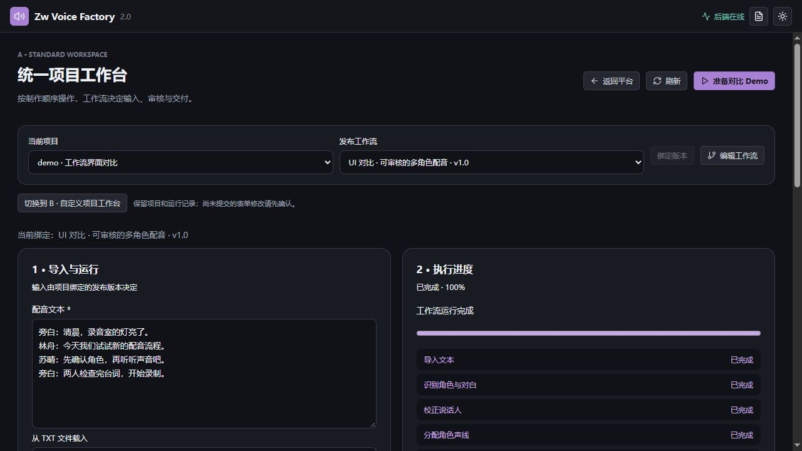
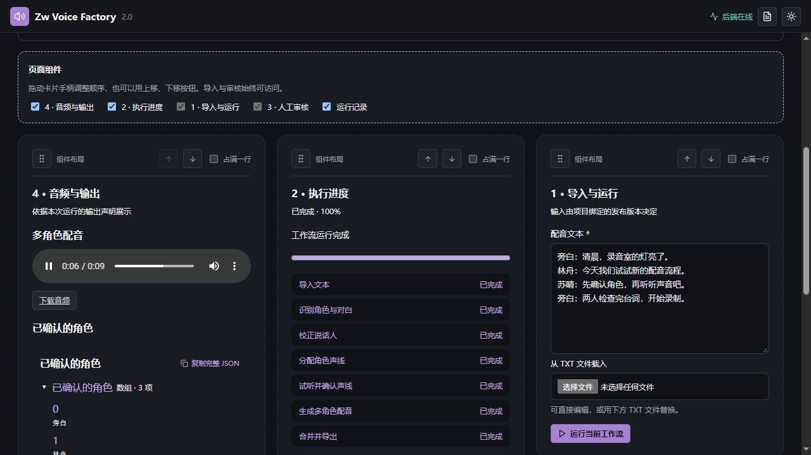

# 工作流项目界面双分支对比

## 已确认的方向

用户希望同时探索两种项目界面方案，以可操作的实际效果决定后续方向，而不是现在选定其中一种。

这里的“分支”指产品代码的 Git 分支，不是工作流中的条件分支。

## 当前基础

- 项目可绑定已发布的工作流，画布负责编辑、验证与发布。
- `ProjectWorkflowPanel` 根据工作流输入声明显示表单，并提供运行历史、执行详情和音频播放。
- 项目运行界面、工作流编排画布是不同的产品入口。
- Dify 默认工作流应用根据公开输入生成表单、展示输出，也支持运行期间的人工输入表单；任意业务页面布局需要额外的界面设计能力。

参考：

- https://docs.dify.ai/en/cloud/use-dify/publish/webapp/workflow-webapp
- https://docs.dify.ai/en/cloud/use-dify/nodes/user-input
- https://docs.dify.ai/en/cloud/use-dify/nodes/human-input

## 本轮实施范围

| 方案 | Git 分支 | 实际操作的体验 |
| --- | --- | --- |
| A：统一项目界面 | `codex/workflow-ui-standard` | 工作流声明决定输入表单、执行进度、人工审核和结果；专业组件放在统一布局中。 |
| B：可编辑页面布局 | `codex/workflow-ui-layout` | 复用相同业务组件，另外提供最小页面编辑器，允许拖动组件、调整分栏并保存布局。 |

用户已要求推进双线制作并提供各自入口。B 首版采用可操作的最小布局编辑器：卡片拖动排序、分栏、宽度、显示管理与显式保存。布局保存在当前浏览器，按项目和已发布工作流分别管理。

A 的入口为平台首页的“A · 统一项目工作台”，可通过 `#workflow-ui/standard/项目ID` 直接访问。B 的入口是“B · 自定义项目工作台”，对应 `#workflow-ui/layout/项目ID`。

当前检出的 B 分支继承 A 的业务实现，并同时保留两个入口；界面内也可以切换到同一项目的另一方案。比较时不需要切分支或启动两套模型服务。A 分支保留统一界面的独立开发检查点。

两边共用后端人工检查点：`human.speakers` 保存逐句说话人校正，`human.voices` 保存角色声线选择。确认前不会启动下游批量生成；审核拒绝会终止本次运行。

“准备对比 Demo”会准备一个独立短对白项目及包含这两个人工检查点的已发布工作流。也可以选择已有项目和工作流，或用 TXT 替换演示文本。

## 建议的共同验收场景

默认使用 [短对白 TXT](demo/workflow-ui-dialogue.txt)、同一工作流及模型参数比较；也可换成斗破苍穹测试文本。已有的长篇 demo 和运行结果保持独立。

1. 选择 TXT 并开始运行。
2. 在人工检查点纠正一条说话人归属。
3. 试听并确认角色声线。
4. 继续执行，真实生成多角色音频并播放、下载。
5. 重新打开项目，查看历史运行和结果。

以任务能否完成、操作是否容易理解、需要多少次操作，以及修改工作流后页面是否正确响应来评价。B 另需验证布局编辑、保存和重新打开后的恢复。

## 布局与数据边界

- 两个 Git 分支从已存档的基线发展，本轮在同一个工作目录依次提交共享实现和 B 布局层。
- 共用工作流、资源、人工审核和运行契约；同一个项目的运行记录可以在 A、B 中查看。
- B 可拖动卡片排序，也可用上移、下移按钮；支持单栏、双栏、三栏和卡片占满一行。
- 输入和人工审核始终显示，进度、结果、历史可隐藏再恢复。
- 布局通过“保存布局”显式保存到当前浏览器，按项目与发布工作流隔离；不写入工作流定义，不跨浏览器同步。
- 切换 A/B 会重新打开工作台，尚未提交的输入或审核编辑需先提交；已批准结果和运行历史由后端保存。
- 启动、停止与自动验证遵循 `AGENTS.md` 中的统一启动器要求。

## 验证入口

`Start-ZwVoice.cmd test -ChecksOnly` 通过统一启动器执行界面回归、TypeScript、生产构建与后端测试，不预加载模型。`Start-ZwVoice.cmd test` 继续覆盖完整模型启动与真实推理。

仅修改前端时可用 `Start-ZwVoice.cmd test -ChecksOnly -CheckScope Frontend`。后端针对性复测可用 `Start-ZwVoice.cmd test -ChecksOnly -BackendTestFilter project_ui_reviews`，筛选表达式按 pytest 的 `-k` 解释，输出明确列出筛选范围。

## 2026-10-23 实测记录

- 统一启动器 `run` 启动成功，已核对可见 owner `cmd.exe` 窗口句柄；`status` 显示服务运行中，GPT-SoVITS、VoxCPM2、轻量 TTS 和本地音色分析就绪，IndexTTS2 按需加载。
- 项目：`demo · 工作流界面对比`，ID `voice-project-6d73fb93b63f496a`。
- 发布工作流：`workflow-2befd39a1dac4592` v1.0；运行：`workflow-run-02add86cb9214150`，7 个节点全部完成。
- A 中通过真实文件选择器导入短对白 TXT，逐句校正林舟、苏晴，选择声线并成功生成试听，然后批准继续。
- 最终 4 个音频片段使用 `gunian`（旁白）、`bazong`（林舟）、`fushiyu`（苏晴）三种声线。合并结果为 `/media/outputs/audio/merged/87448a1d0349.wav`，播放器读取时长为 9.4805 秒，无播放错误，已在 B 播放并通过下载链接取得文件。
- A/B 切换后是同一个运行结果。B 已实测拖动排序、按钮排序、三栏、取消占满一行、隐藏/恢复历史，保存并刷新后顺序、宽度、分栏及可见性恢复。
- 后端全量首轮 179 项通过，唯一失败是新增测试将异步审核响应错断言为 200；修正为接口约定的 202 后，该集成测试通过（1 passed，179 deselected）。该测试还覆盖无效编辑不批准、应用重建后继续、下游收到校正结果、重复审核冲突及新运行仍需人工审核。
- B 的 7 项前置回归、TypeScript 检查与生产构建通过。生产构建仍有既有大包提示，不阻断构建。
- 本轮没有再次执行包含所有模型真实推理的完整 `test`；真实业务验证使用上述极速路线，不能据此宣称质量路线全部回归通过。

本轮实测仍可见的限制：默认文本分析器未将“角色名：台词”的剧本格式自动归为角色，需要在审核节点校正；原始角色前缀也会保留在生成文本中。因此本轮证明的是可人工校正的完整生产链路，不代表角色识别准确率已改善。质量路线的参考音频审核和任意业务组件的可视化页面设计不在这一版布局编辑器范围内。

